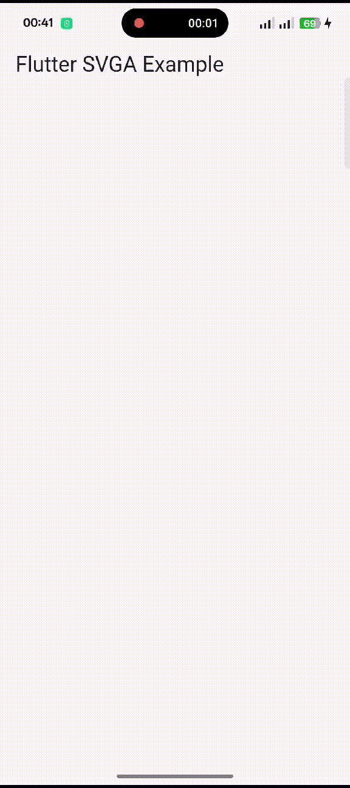
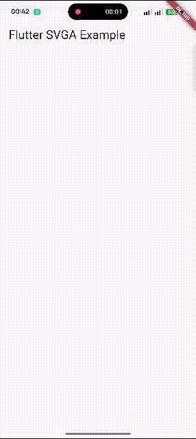

<div align="center">

# flutter_svga

**A high-performance, actively maintained Flutter package for parsing and rendering SVGA animations.**

[](https://pub.dev/packages/flutter_svga)
[](https://pub.dev/packages/flutter_svga/score)
[](https://pub.dev/packages/flutter_svga/score)
[](LICENSE)
[](https://pub.dev/packages/flutter_svga)

<br/>


&nbsp;&nbsp;&nbsp;&nbsp;


</div>

---

## ✨ What's New in `v0.0.14`

- 🔊 **Complete Audio Volume & Mute Architecture** (#9, PR #10):
  - Control audio directly on `SVGAAnimationController` via `volume` (`0.0`–`1.0`), `muted`, `toggleMute()`, and `effectiveVolume`, or pass `volume` and `muted` directly to the constructor.
  - Declarative `volume` and `muted` properties added directly to `SVGAEasyPlayer`.
- ⏯️ **True Pause & Resume Support**:
  - Added `controller.pause()` and `controller.resume()` to seamlessly pause and resume both animation frames and active audio tracks from the exact frame position.
- 🧩 **Enhanced `SVGAEasyPlayer`**:
  - Added `volume`, `muted`, `loops`, `dynamicCallback`, `onFinished`, `filterQuality`, `allowDrawingOverflow`, `clearsAfterStop`, and `preferredSize`.
- 🛡️ **Hardened Parser, Cache & Renderer**:
  - Validates HTTP status codes before caching, automatically evicts corrupted cache entries, supports per-call `useCache: false`, detects both `ID3` and raw MPEG frame-sync MP3 streams, and safely clamps sprite frame ranges and color channels (#11).
- 🚀 **Flutter `3.47.7` & Dart `^3.13.5`**:
  - Upgraded SDK constraints and all package dependencies (`archive: ^4.5.2`, `protobuf: ^6.1.0`, `audioplayers: ^6.8.1`, `path_provider: ^2.1.6`).

---

## 📖 Table of Contents

- [Why `flutter_svga`?](#-why-flutter_svga)
- [Installation](#-installation)
- [Migrating from `svgaplayer_flutter`](#-migrating-from-svgaplayer_flutter)
- [Quick Start (`SVGAEasyPlayer`)](#-quick-start-svgaeasyplayer)
- [Advanced Usage (`SVGAAnimationController`)](#-advanced-usage-svgaanimationcontroller)
- [Audio & Volume Control](#-audio--volume-control)
- [Playback Controls](#-playback-controls)
- [Dynamic Elements (Text, Images, Custom Drawers)](#-dynamic-elements)
- [Intelligent Caching (`SVGACache`)](#-intelligent-caching)
- [Memory Management](#-memory-management)
- [API Reference](#-api-reference)
- [Supported Platforms](#-supported-platforms)
- [Troubleshooting](#-troubleshooting)
- [Contributors](#-authors--contributors)

---

## 🎯 Why `flutter_svga`?

Unlike **`svgaplayer_flutter`** (archived since Feb 2023), `flutter_svga` is **actively maintained** for modern Flutter & Dart SDKs with built-in disk caching, integrated audio playback, volume control, and memory optimization.

| Feature | `flutter_svga` | `svgaplayer_flutter` | `lottie` |
| :--- | :--- | :--- | :--- |
| **Maintenance Status** | ✅ **Active** | ❌ Archived (Feb 2023) | ✅ Active |
| **Built-in Disk Cache** | ✅ Automatic (`SVGACache`) | ❌ No | ⚠️ Manual |
| **Integrated Audio** | ✅ Yes (with Volume & Mute) | ❌ No | ⚠️ External |
| **File Format & Size** | 🟢 Compact Binary (`.svga`) | 🟢 Compact Binary (`.svga`) | 🟡 Larger JSON |
| **Dynamic Elements** | ✅ Text, Images, Custom Drawers | ⚠️ Limited | ✅ Yes |
| **Memory Optimization** | ✅ Protobuf Heap Release | ❌ High Heap Usage | ⚡ Good |
| **Flutter 3.47+ / Dart 3.13+** | ✅ Supported | ❌ Outdated Dependencies | ✅ Supported |

---

## 📦 Installation

Add `flutter_svga` to your `pubspec.yaml`:

```yaml
dependencies:
  flutter_svga: ^0.0.14
```

Then fetch packages:

```sh
flutter pub get
```

---

## 🔄 Migrating from `svgaplayer_flutter`

Switching from the archived `svgaplayer_flutter` package takes less than a minute:

1. **Update `pubspec.yaml`**:
   ```yaml
   dependencies:
     # svgaplayer_flutter: ^2.2.0  # Remove archived package
     flutter_svga: ^0.0.14         # Add flutter_svga
   ```

2. **Update imports**:
   ```dart
   // Old
   // import 'package:svgaplayer_flutter/svgaplayer_flutter.dart';

   // New
   import 'package:flutter_svga/flutter_svga.dart';
   ```

3. **Zero breaking changes**: Existing `SVGAAnimationController`, `SVGAImage`, `SVGAEasyPlayer`, and `SVGAParser` code works out of the box—now with automatic caching, audio support, volume control, and lower memory usage.

---

## 🎬 Quick Start (`SVGAEasyPlayer`)

`SVGAEasyPlayer` handles loading, caching, controller lifecycle, and disposal automatically.

### Play from Assets or Network URL

```dart
import 'package:flutter/material.dart';
import 'package:flutter_svga/flutter_svga.dart';

class SimpleSVGAExample extends StatelessWidget {
  const SimpleSVGAExample({super.key});

  @override
  Widget build(BuildContext context) {
    return const Column(
      mainAxisAlignment: MainAxisAlignment.center,
      children: [
        // Load from local bundle assets
        SVGAEasyPlayer(
          assetsName: 'assets/sample_with_audio.svga',
          fit: BoxFit.contain,
        ),

        // Load from network URL (cached automatically)
        SVGAEasyPlayer(
          resUrl: 'https://cdn.jsdelivr.net/gh/svga/SVGA-Samples@master/EmptyState.svga',
          fit: BoxFit.cover,
        ),
      ],
    );
  }
}
```

### Declarative Audio Volume, One-Shot Playback & Callbacks

```dart
SVGAEasyPlayer(
  assetsName: 'assets/gift_effect.svga',
  volume: 0.5,          // 50% audio volume
  muted: false,         // Mute/unmute declaratively
  loops: false,         // Play once instead of looping
  preferredSize: const Size(300, 300),
  dynamicCallback: (movie) {
    // Customize dynamic layers before playback starts
    movie.dynamicItem.setHidden(true, 'watermark_layer');
  },
  onFinished: () {
    debugPrint('Gift animation completed!');
  },
)
```

---

## 🎭 Advanced Usage (`SVGAAnimationController`)

For fine-grained control over frames, playback state, and dynamic updates, use `SVGAAnimationController` with `SVGAImage`:

```dart
import 'package:flutter/material.dart';
import 'package:flutter_svga/flutter_svga.dart';

class CustomSVGAPlayer extends StatefulWidget {
  const CustomSVGAPlayer({super.key});

  @override
  State<CustomSVGAPlayer> createState() => _CustomSVGAPlayerState();
}

class _CustomSVGAPlayerState extends State<CustomSVGAPlayer>
    with SingleTickerProviderStateMixin {
  late final SVGAAnimationController _controller;

  @override
  void initState() {
    super.initState();
    _controller = SVGAAnimationController(
      vsync: this,
      volume: 0.8, // Optional initial volume (0.0 to 1.0)
      muted: false,
    );
    _loadAnimation();
  }

  Future<void> _loadAnimation() async {
    final videoItem = await SVGAParser.shared.decodeFromAssets(
      'assets/sample_with_audio.svga',
    );
    if (!mounted) {
      videoItem.dispose();
      return;
    }
    _controller.videoItem = videoItem;
    _controller.repeat();
  }

  @override
  void dispose() {
    _controller.dispose();
    super.dispose();
  }

  @override
  Widget build(BuildContext context) {
    return SVGAImage(
      _controller,
      fit: BoxFit.contain,
      filterQuality: FilterQuality.medium,
      clearsAfterStop: false,
      preferredSize: const Size(320, 320),
    );
  }
}
```

---

## 🔊 Audio & Volume Control

`flutter_svga` provides built-in audio layer synchronization and real-time volume management (ideal for live-streaming gift effects and interactive UI):

```dart
// 1. Initialize controller with volume/mute settings
final controller = SVGAAnimationController(
  vsync: this,
  volume: 0.7,
  muted: false,
);

// 2. Adjust volume at runtime (automatically clamped between 0.0 and 1.0)
controller.volume = 0.5;   // 50% volume
controller.volume = 0.0;   // Silent
controller.volume = 1.0;   // Full volume

// 3. Mute or unmute without losing the saved volume level
controller.muted = true;   // Effective volume becomes 0.0, but controller.volume stays 1.0
controller.muted = false;  // Restores audio to controller.volume (1.0)

// 4. Toggle mute state with a single call
controller.toggleMute();

// 5. Read effective output volume (0.0 when muted, otherwise controller.volume)
debugPrint('Effective volume: ${controller.effectiveVolume}');
```

---

## 🎯 Playback Controls

```dart
controller.forward();       // Play once from current frame to end
controller.repeat();        // Loop continuously
controller.pause();         // Pause animation and audio at current frame
controller.resume();        // Resume animation and audio from paused frame
controller.stop();          // Stop playback and pause audio
controller.reset();         // Reset to frame 0 and stop audio
controller.clear();         // Clear the canvas

// Seek to a specific normalized progress (0.0 to 1.0)
controller.value = 0.5;

// Inspect frame metrics
final int current = controller.currentFrame;
final int total = controller.frames;
final bool paused = controller.isPaused;
```

---

## 🎨 Dynamic Elements

Replace text, swap images, hide layers, or run custom `Canvas` drawing on specific sprite layers at runtime via `MovieEntity.dynamicItem`:

### 1. Dynamic Text

```dart
controller.videoItem!.dynamicItem.setText(
  TextPainter(
    text: const TextSpan(
      text: 'Hello SVGA!',
      style: TextStyle(
        color: Colors.white,
        fontSize: 24,
        fontWeight: FontWeight.bold,
      ),
    ),
    textDirection: TextDirection.ltr,
  ),
  'banner_text_layer',
);
```

### 2. Dynamic Image Replacement

```dart
// From network URL
await controller.videoItem!.dynamicItem.setImageWithUrl(
  'https://example.com/avatar.png',
  'avatar_layer',
);

// Or with a decoded dart:ui Image
controller.videoItem!.dynamicItem.setImage(decodedUiImage, 'avatar_layer');
```

### 3. Custom Canvas Drawer

```dart
controller.videoItem!.dynamicItem.setDynamicDrawer(
  (Canvas canvas, int frameIndex) {
    final paint = Paint()..color = Colors.amber;
    canvas.drawCircle(const Offset(44, 44), 20, paint);
  },
  'custom_effect_layer',
);
```

### 4. Hide / Show Layers & Reset

```dart
// Hide a specific sprite layer
controller.videoItem!.dynamicItem.setHidden(true, 'optional_badge_layer');

// Clear all dynamic customizations
controller.videoItem!.dynamicItem.reset();
```

---

## 🗄️ Intelligent Caching

`SVGAParser` automatically caches raw SVGA files on disk via `SVGACache.shared` with MD5-hashed keys, expiration policies, and size limits.

```dart
// Caching is enabled by default — no code changes required
final movie = await SVGAParser.shared.decodeFromURL(
  'https://example.com/animation.svga',
);

// Bypass cache for a specific call when needed
final freshMovie = await SVGAParser.shared.decodeFromURL(
  'https://example.com/live_animation.svga',
  useCache: false,
);

// Configure global cache policy (e.g., in main())
SVGACache.shared
  ..setEnabled(true)
  ..setMaxCacheSize(50 * 1024 * 1024) // 50 MB max size (default: 100 MB)
  ..setMaxAge(const Duration(days: 3)); // 3 days TTL (default: 7 days)

// Inspect or clear cache
final stats = await SVGACache.shared.getStats();
debugPrint('Cached files: ${stats['fileCount']}, Size: ${stats['size']} bytes');

await SVGACache.shared.remove('https://example.com/animation.svga');
await SVGACache.shared.clear();
```

See [CACHE.md](CACHE.md) for full caching architecture details.

---

## 🧠 Memory Management

- **Automatic Protobuf Cleanup**: `SVGAParser` automatically calls `movieItem.releaseMemory()` after decoding images and audio, clearing raw protobuf image byte maps to minimize Dart heap usage (#8).
- **Auto-Release on Controller Disposal**: By default, `MovieEntity.autorelease` is `true`, so disposing `SVGAAnimationController` (or reassigning `controller.videoItem`) automatically disposes decoded `ui.Image` bitmaps and audio players.
- **Reusing a `MovieEntity` Across Multiple Controllers**: If you share a single decoded `MovieEntity` across multiple controllers, set `movieEntity.autorelease = false` and call `movieEntity.dispose()` manually when no longer needed.

---

## 📚 API Reference

### `SVGAEasyPlayer`

| Parameter | Type | Default | Description |
| :--- | :--- | :--- | :--- |
| `assetsName` | `String?` | `null` | Asset bundle path to load (`.svga`). |
| `resUrl` | `String?` | `null` | Remote HTTP/HTTPS URL to load (`.svga`). |
| `fit` | `BoxFit` | `BoxFit.contain` | How the animation is inscribed into the layout box. |
| `filterQuality` | `FilterQuality` | `FilterQuality.low` | Image sampling filter quality during rendering. |
| `allowDrawingOverflow` | `bool?` | `null` | Whether drawing is allowed to overflow canvas bounds. |
| `clearsAfterStop` | `bool` | `true` | Clears canvas when a non-looping animation completes. |
| `preferredSize` | `Size?` | `null` | Explicit widget size constraint (defaults to SVGA viewBox). |
| `volume` | `double` | `1.0` | Audio volume (`0.0` to `1.0`). |
| `muted` | `bool` | `false` | Mutes audio playback while preserving `volume`. |
| `loops` | `bool` | `true` | Loops animation continuously (`repeat`) or plays once (`forward`). |
| `dynamicCallback` | `void Function(MovieEntity)?` | `null` | Callback invoked after decoding to configure `dynamicItem`. |
| `onFinished` | `VoidCallback?` | `null` | Callback invoked when one-shot playback (`loops: false`) completes. |

### `SVGAAnimationController`

| Member | Type | Description |
| :--- | :--- | :--- |
| `videoItem` | `MovieEntity?` | Gets or sets the active SVGA movie entity and initializes duration & audio layers. |
| `volume` | `double` | Gets or sets audio volume (`0.0` to `1.0`, clamped). |
| `muted` | `bool` | Gets or sets mute state without altering `volume`. |
| `effectiveVolume` | `double` | Read-only effective output volume (`0.0` if muted, otherwise `volume`). |
| `toggleMute()` | `void` | Toggles `muted` between `true` and `false`. |
| `pause()` | `void` | Pauses animation and audio at the current frame. |
| `resume()` | `TickerFuture` | Resumes animation and audio from the paused frame. |
| `isPaused` | `bool` | Whether the controller is currently paused via `pause()`. |
| `currentFrame` | `int` | Current zero-based frame index (`0` to `frames - 1`). |
| `frames` | `int` | Total number of frames in `videoItem`. |

---

## 📱 Supported Platforms

| Platform | Animation Rendering | Caching (`SVGACache`) | Audio Playback |
| :--- | :---: | :---: | :---: |
| **Android** | ✅ Yes | ✅ Yes | ✅ Yes |
| **iOS** | ✅ Yes | ✅ Yes | ✅ Yes |
| **macOS** | ✅ Yes | ✅ Yes | ✅ Yes |
| **Windows** | ✅ Yes | ✅ Yes | ✅ Yes |
| **Linux** | ✅ Yes | ✅ Yes | ✅ Yes |
| **Web** | ✅ Yes | ⚠️ No-op fallback | ⚠️ Not supported |

---

## 🛠 Troubleshooting

<details>
<summary><b>1. Black or blank screen when loading from assets</b></summary>

Ensure the `.svga` file is declared in your app's `pubspec.yaml` under `flutter: assets:`:
```yaml
flutter:
  assets:
    - assets/sample.svga
```
</details>

<details>
<summary><b>2. Animation does not start after decoding</b></summary>

Always assign `_controller.videoItem = videoItem` **before** calling `_controller.repeat()` or `_controller.forward()`. Assigning `videoItem` sets the controller's `duration` from the SVGA header.
</details>

<details>
<summary><b>3. Controlling gift sound effects in live streams</b></summary>

Use `controller.volume = 0.5` or `controller.muted = true` (or pass `volume` / `muted` to `SVGAEasyPlayer`). Changes take effect immediately on active audio layers without restarting the animation.
</details>

---

## 👨‍💻 Authors & Contributors

### Core Author
- **[5alafawyyy](https://github.com/5alafawyyy)** — Lead Developer & Maintainer

### Contributors
Special thanks to everyone who has contributed features, fixes, and reports:

| Contributor | Contribution | Issues / PRs |
| :--- | :--- | :--- |
| **[Sansuihe](https://github.com/Sansuihe)** | Audio volume control, MD5 audio cache collision fix, & range report | #3, #6, #9, #10, #11 |
| **[wonderkidshihab](https://github.com/wonderkidshihab)** | Intelligent disk caching system & duplicate audio playback fix | #3, #4 |
| **[jianleepb](https://github.com/jianleepb)** | Protobuf heap memory profiling & optimization report | #8 |
| **[tungpham6195](https://github.com/tungpham6195)** / **[thomas-p95](https://github.com/thomas-p95)** | Protobuf `^6.0.0` compatibility report | #7 |
| **[Abbasi233](https://github.com/Abbasi233)** | Disposed `AudioPlayer` lifecycle crash report | #1 |

---

## 📜 License

This project is licensed under the **MIT License** — see the [LICENSE](LICENSE) file for details.
